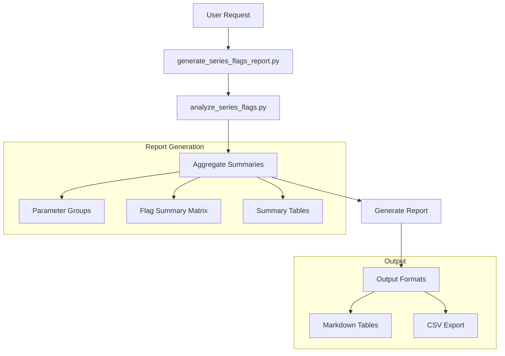

# Future Plan: FEWS Quality Flag Report Generator

## Overview
This plan outlines the implementation of a periodic reporting tool that builds upon the `analyze_series_flags` functionality to provide comprehensive summaries of FEWS quality flags across multiple locations and parameters.

IMPORTANT: Like the core tool, this reporting tool ONLY summarizes existing flags and sources. It does NOT:
- Compute any patterns in the measurement values
- Detect any anomalies or trends
- Set or modify any flags
- Make any quality judgments

## Architecture

### System Architecture Diagram


## Implementation Details

### 1. Data Models

#### SeriesFlagsReportInput
```python
class SeriesFlagsReportInput(BaseModel):
    location_ids: List[str] = Field(..., description="List of location IDs to analyze")
    parameter_ids: List[str] = Field(..., description="List of parameter IDs to analyze")
    start_time: datetime = Field(..., description="Start time for analysis")
    end_time: datetime = Field(..., description="End time for analysis")
    group_by_parameter_group: bool = Field(
        False,
        description="Whether to group parameters by their parameter group"
    )
    report_period: str = Field(
        ...,
        description="Period for report aggregation ('1W' for weekly, '1M' for monthly)"
    )
```

#### ParameterGroup
```python
class ParameterGroup(BaseModel):
    """Parameter grouping information"""
    group_id: str
    parameters: List[str]
    description: str
```

#### FlagSummaryMatrix
```python
class FlagSummaryMatrix(BaseModel):
    """Summary of flags for a location-parameter combination"""
    location_id: str
    parameter_id: str
    parameter_group: Optional[str]
    flag_counts: Dict[int, int]  # Flag number to count
    flag_percentages: Dict[int, float]  # Flag number to percentage
    source_counts: Dict[str, int]  # Source code to count
    source_percentages: Dict[str, float]  # Source code to percentage
    total_values: int
```

#### SeriesFlagsReport
```python
class SeriesFlagsReport(BaseModel):
    """Complete periodic report output"""
    period: str  # e.g., "2024-W10" or "2024-03"
    start_time: datetime
    end_time: datetime
    locations: List[str]
    parameters: List[str]
    parameter_groups: Optional[Dict[str, ParameterGroup]]
    summary_matrix: List[FlagSummaryMatrix]
    markdown_report: str  # The formatted markdown report
    csv_export: str  # CSV format for further processing
```

### 2. Implementation Steps

1. **Report Generation Function**
```python
async def generate_series_flags_report(
    ctx: RunContext[Deps],
    input: SeriesFlagsReportInput
) -> SeriesFlagsReport:
    """
    Generate a periodic report summarizing FEWS flags across multiple series.

    This tool ONLY:
    1. Collects flag summaries for each location-parameter combination
    2. Groups these summaries by parameter group if requested
    3. Formats the summaries into reports

    It does NOT:
    - Analyze measurement values
    - Detect patterns or anomalies
    - Set or modify any flags
    """
    # 1. Get parameter groups if needed
    parameter_groups = await get_parameter_groups() if input.group_by_parameter_group else None

    # 2. Generate summary matrix
    summary_matrix = []
    for location_id in input.location_ids:
        for parameter_id in input.parameter_ids:
            # Get flag summary for location-parameter combination
            flags_summary = await analyze_series_flags(
                ctx,
                SeriesFlagsInput(
                    location_id=location_id,
                    parameter_id=parameter_id,
                    start_time=input.start_time,
                    end_time=input.end_time
                )
            )

            # Add to matrix
            summary_matrix.append(
                FlagSummaryMatrix(
                    location_id=location_id,
                    parameter_id=parameter_id,
                    parameter_group=get_parameter_group(parameter_id, parameter_groups),
                    flag_counts=flags_summary.counts.flag_counts,
                    flag_percentages=flags_summary.counts.flag_percentages,
                    source_counts=flags_summary.counts.source_counts,
                    source_percentages=flags_summary.counts.source_percentages,
                    total_values=flags_summary.total_values
                )
            )

    # 3. Generate report formats
    markdown_report = generate_markdown_report(summary_matrix, parameter_groups)
    csv_export = generate_csv_export(summary_matrix)

    return SeriesFlagsReport(
        period=format_period(input.start_time, input.report_period),
        start_time=input.start_time,
        end_time=input.end_time,
        locations=input.location_ids,
        parameters=input.parameter_ids,
        parameter_groups=parameter_groups,
        summary_matrix=summary_matrix,
        markdown_report=markdown_report,
        csv_export=csv_export
    )
```

### 3. Output Format

The tool will provide structured reports in both markdown and CSV formats:

1. **Markdown Report Structure**
```markdown
# FEWS Flag Summary Report for {period}
Period: {start_date} to {end_date}

## Flag Summary Matrix by Location and Parameter

### Parameter Group: {group_name} (if grouped)
| Location | Parameter | Flag Counts | Flag Sources |
|----------|-----------|-------------|--------------|
| Loc1     | Par1      | 0: 800      | IMP: 850    |
|          |           | 3: 100      | SN: 50      |
|          |           | 9: 50       | HN: 30      |
```

2. **CSV Export Format**
```csv
location_id,parameter_id,parameter_group,flag_0_count,flag_3_count,...,imp_count,sn_count,...
Loc1,Par1,Group1,800,100,...,850,50,...
```

### 4. Testing Strategy

1. **Unit Tests**
   - Report generation logic
   - Period aggregation
   - Parameter grouping
   - Output formatting

2. **Integration Tests**
   - Full workflow with analyze_series_flags
   - Multiple location-parameter combinations
   - Different time periods
   - Parameter group handling

## Dependencies

- Core `analyze_series_flags` tool
- Parameter group metadata access
- Standard Python libraries for report generation

## Future Enhancements

1. **Report Features**
   - Custom report templates
   - Additional export formats (JSON)
   - Report scheduling
   - Report archiving

2. **Aggregation Options**
   - Custom grouping criteria
   - Different time period options
   - Location grouping support
