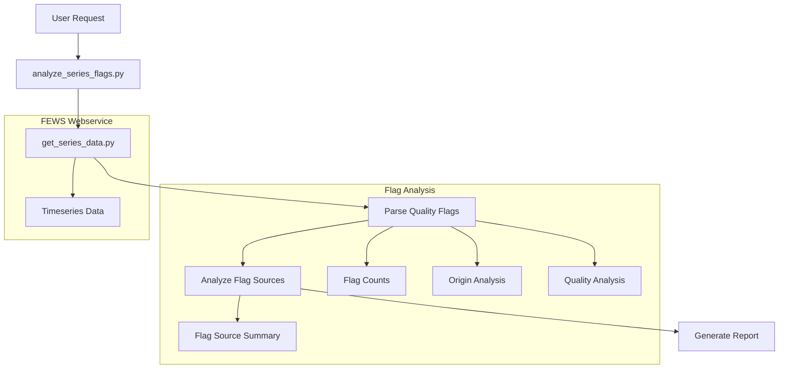

# Plan: FEWS Quality Flag Analysis Tool Implementation

## Overview
This plan outlines the implementation of a tool that analyzes FEWS quality flags and flag sources to provide insights into data quality. The tool will build upon our existing `get_series_data` functionality and focus specifically on analyzing the standardized FEWS flag system.

IMPORTANT: This tool ONLY analyzes existing flags and flag sources set by FEWS. It does NOT:
- Compute any patterns in the measurement values
- Detect any anomalies or trends
- Set or modify any flags
- Make any quality judgments

## Architecture

### System Architecture Diagram


## Implementation Details

### 1. Data Models

#### Standard FEWS Flag Mappings
```python
QUALITY_FLAGS = {
    0: FlagDefinition(
        flag=0,
        origin="Original",
        quality="Reliable",
        description="Original value, passes all validation criteria"
    ),
    1: FlagDefinition(
        flag=1,
        origin="Corrected",
        quality="Reliable",
        description="Original value corrected through interpolation or manual editing"
    ),
    2: FlagDefinition(
        flag=2,
        origin="Completed",
        quality="Reliable",
        description="Original value was missing. Value has been filled in through interpolation, transformation (e.g. stage discharge) or a model"
    ),
    3: FlagDefinition(
        flag=3,
        origin="Original",
        quality="Doubtful",
        description="Observed value retrieved from external data source. Value is valid, but marked as suspect due to soft validation limits being exceeded"
    ),
    4: FlagDefinition(
        flag=4,
        origin="Corrected",
        quality="Doubtful",
        description="Original value was removed and corrected. However, the corrected value is doubtful due to validation limits"
    ),
    5: FlagDefinition(
        flag=5,
        origin="Completed",
        quality="Doubtful",
        description="Original value was missing. Value has been filled in as above, but resulting value is doubtful due to limits in transformation/interpolation or input value used for transformation being doubtful"
    ),
    6: FlagDefinition(
        flag=6,
        origin="Original",
        quality="Unreliable",
        description="Observed value retrieved from external data source. Value is invalid due to validation limits set. Value is marked as unreliable and will not be used in transformations and model calculations"
    ),
    7: FlagDefinition(
        flag=7,
        origin="Corrected",
        quality="Unreliable",
        description="Original value was removed and corrected. However, corrected value is unreliable"
    ),
    8: FlagDefinition(
        flag=8,
        origin="Completed",
        quality="Unreliable",
        description="Original value was missing. Value has been filled in as above, but resulting value is unreliable"
    ),
    9: FlagDefinition(
        flag=9,
        origin="Original",
        quality="Unreliable",
        description="Missing value in originally observed series. Note this is a special form of both Original/Unreliable and Original/Reliable"
    )
}

FLAG_SOURCES = {
    # Primary Validation Sources
    "IMP": FlagSourceDefinition(
        code="IMP",
        description="Flag is imported",
        validation_type="primary"
    ),
    "SN": FlagSourceDefinition(
        code="SN",
        description="Soft minimum exceeded",
        validation_type="primary"
    ),
    "HN": FlagSourceDefinition(
        code="HN",
        description="Hard minimum exceeded",
        validation_type="primary"
    ),
    "SX": FlagSourceDefinition(
        code="SX",
        description="Soft maximum exceeded",
        validation_type="primary"
    ),
    "HX": FlagSourceDefinition(
        code="HX",
        description="Hard maximum exceeded",
        validation_type="primary"
    ),
    "ROR": FlagSourceDefinition(
        code="ROR",
        description="Rate of rise",
        validation_type="primary"
    ),
    "ROF": FlagSourceDefinition(
        code="ROF",
        description="Rate of fall",
        validation_type="primary"
    ),
    "SR": FlagSourceDefinition(
        code="SR",
        description="Same reading",
        validation_type="primary"
    ),
    "TS": FlagSourceDefinition(
        code="TS",
        description="Temporary shift",
        validation_type="primary"
    ),
    "OSC": FlagSourceDefinition(
        code="OSC",
        description="Oscillation",
        validation_type="primary"
    ),

    # Secondary Validation Sources
    "SC": FlagSourceDefinition(
        code="SC",
        description="Secondary validation, series comparison",
        validation_type="secondary"
    ),
    "FC": FlagSourceDefinition(
        code="FC",
        description="Secondary validation, flag comparison",
        validation_type="secondary"
    ),
    "MK": FlagSourceDefinition(
        code="MK",
        description="Secondary validation, Mann-Kendall test",
        validation_type="secondary"
    ),
    "SVP": FlagSourceDefinition(
        code="SVP",
        description="Secondary validation, Flag persistency",
        validation_type="secondary"
    ),
    "SFP": FlagSourceDefinition(
        code="SFP",
        description="Start flag persistency",
        validation_type="secondary"
    ),
    "MAN": FlagSourceDefinition(
        code="MAN",
        description="Manual edit",
        validation_type="secondary"
    ),
    "CA": FlagSourceDefinition(
        code="CA",
        description="Conditional aggregation",
        validation_type="secondary"
    )
}
```

#### SeriesFlagsInput
```python
class SeriesFlagsInput(BaseModel):
    location_id: str = Field(..., description="Location ID to analyze")
    parameter_id: str = Field(..., description="Parameter ID to analyze")
    start_time: datetime = Field(..., description="Start time for analysis")
    end_time: datetime = Field(..., description="End time for analysis")
```

#### FlagDefinition
```python
class FlagDefinition(BaseModel):
    """Standard FEWS flag definition"""
    flag: int
    origin: str  # Original/Corrected/Completed
    quality: str  # Reliable/Doubtful/Unreliable
    description: str
```

#### FlagSourceDefinition
```python
class FlagSourceDefinition(BaseModel):
    """Standard FEWS flag source definition"""
    code: str  # e.g., 'IMP', 'SN', 'HN', etc.
    description: str
    validation_type: str = Field(
        ...,
        description="Type of validation (primary/secondary/custom)",
        example="primary"
    )
```

#### FlagCount
```python
class FlagCount(BaseModel):
    """Count of a specific FEWS flag occurrence"""
    flag: int
    count: int
    percentage: float
```

#### FlagSourceCount
```python
class FlagSourceCount(BaseModel):
    """Count of a specific FEWS flag source occurrence"""
    source: FlagSourceDefinition
    count: int
    percentage: float
```

#### QualityThresholds
```python
class QualityThresholds(BaseModel):
    """Standard FEWS quality percentage thresholds for reporting"""
    EXCELLENT = 95.0  # Green (00FF00)
    VERY_GOOD = 90.0  # Light green (D0F5A9)
    GOOD = 80.0       # Orange (F2F5A9)
    MODERATE = 50.0   # Light red (F5DA81)
    POOR = 0.0        # Red (F79F81)
```

#### FlagCounts
```python
class FlagCounts(BaseModel):
    """Counts of FEWS flags and sources in the timeseries"""
    # Basic counts
    total_values: int
    missing_values: int

    # Quality level counts from flags
    reliable_count: int
    doubtful_count: int
    unreliable_count: int

    # Quality level percentages
    reliable_percentage: float
    doubtful_percentage: float
    unreliable_percentage: float

    # Flag source counts
    primary_source_counts: Dict[str, int]    # e.g., {"SN": 10, "HN": 5}
    secondary_source_counts: Dict[str, int]  # e.g., {"SC": 2, "MK": 1}

    # Flag source percentages
    primary_source_percentages: Dict[str, float]    # e.g., {"SN": 10.0, "HN": 5.0}
    secondary_source_percentages: Dict[str, float]  # e.g., {"SC": 2.0, "MK": 1.0}
```

#### SeriesFlagsSummary
```python
class SeriesFlagsSummary(BaseModel):
    """Summary of FEWS flags in a timeseries"""
    # Basic information
    total_values: int
    period: DateRange

    # Standard FEWS flag definitions
    flag_definitions: Dict[int, FlagDefinition]
    flag_source_definitions: Dict[str, FlagSourceDefinition]

    # Actual counts from timeseries
    flag_counts: List[FlagCount]
    flag_source_counts: List[FlagSourceCount]

    # Summary counts
    counts: FlagCounts
```

#### DataGaps
```python
class DataGaps(BaseModel):
    """Analysis of missing data periods"""
    total_gaps: int
    total_missing_values: int
    missing_percentage: float
    longest_gap: int
    gap_periods: List[DateRange]
```

#### DateRange
```python
class DateRange(BaseModel):
    """A period between two dates"""
    start: datetime
    end: datetime
    duration: timedelta
```

### 2. Error Handling

1. **Input Validation**
```python
class SeriesFlagsError(Exception):
    """Base exception for series flags analysis"""
    pass

class InvalidTimeRangeError(SeriesFlagsError):
    """Invalid time range specified"""
    pass

class CustomFlagsConfigError(SeriesFlagsError):
    """Error in custom flags configuration"""
    pass

class DataRetrievalError(SeriesFlagsError):
    """Error retrieving data from get_series_data"""
    pass
```

2. **Time Range Validation**
```python
def validate_time_range(start_time: datetime, end_time: datetime) -> None:
    """
    Validate the analysis time range.

    Checks:
    - start_time < end_time
    - Range not too large (configurable max duration)
    - Dates not in future
    """
```

3. **Custom Flags Validation**
```python
def validate_custom_flags_config(config_path: str) -> None:
    """
    Validate custom flags configuration XML.

    Checks:
    - File exists and is readable
    - Valid XML structure
    - Required elements present
    - No duplicate flag IDs
    """
```

### 3. Implementation Steps

1. **Flag Counting Function**
```python
async def count_series_flags(
    values: List[TimeseriesValue]
) -> Dict[str, Any]:
    """
    Count occurrences of existing FEWS flags in timeseries.

    This function ONLY counts flags that are already set in the timeseries.
    It does NOT:
    - Analyze the measurement values
    - Compute any statistics
    - Set or modify any flags

    Returns:
        Dict containing counts of existing flags
    """
```

2. **Flag Source Counting Function**
```python
async def count_flag_sources(
    values: List[TimeseriesValue]
) -> Dict[str, Any]:
    """
    Count occurrences of existing FEWS flag sources.

    This function ONLY counts flag sources that are already set.
    It does NOT:
    - Determine new flag sources
    - Analyze measurement values
    - Set or modify any flag sources

    Returns:
        Dict containing counts of existing flag sources
    """
```

3. **Main Tool Implementation**
```python
async def analyze_series_flags(
    ctx: RunContext[Deps],
    input: SeriesFlagsInput
) -> SeriesFlagsSummary:
    """
    Summarize FEWS flags in a timeseries.

    This tool ONLY:
    1. Retrieves timeseries with flags from FEWS
    2. Counts occurrences of existing flags
    3. Groups and summarizes these counts
    4. Formats results for reporting

    It does NOT:
    - Analyze measurement values
    - Detect patterns or anomalies
    - Set or modify any flags
    """
    # 1. Get timeseries with flags
    series_data = await get_series_data(ctx, input)

    # 2. Count flags and sources
    flag_counts = await count_series_flags(series_data.values)
    source_counts = await count_flag_sources(series_data.values)

    # 3. Create summary
    return SeriesFlagsSummary(
        total_values=len(series_data.values),
        period=DateRange(start=input.start_time, end=input.end_time),
        flag_definitions=get_fews_flag_definitions(),
        flag_source_definitions=get_fews_source_definitions(),
        flag_counts=flag_counts["counts"],
        flag_source_counts=source_counts["counts"],
        counts=create_flag_counts(flag_counts, source_counts)
    )
```

### 4. Output Format

The tool will provide a structured analysis report in markdown format:

1. **Flag Distribution Table**
```markdown
| Flag | Origin    | Quality    | Count | Percentage | Description |
|------|-----------|------------|-------|------------|-------------|
| 0    | Original  | Reliable   | 800   | 80%        | Original value |
| 3    | Original  | Doubtful   | 100   | 10%        | Soft validation |
...
```

2. **Flag Source Distribution**
```markdown
| Source | Description | Count | Percentage |
|--------|-------------|-------|------------|
| IMP    | Imported    | 850   | 85%        |
| SN     | Soft min    | 50    | 5%         |
| HX     | Hard max    | 30    | 3%         |
...
```

3. **Quality Summary**
```markdown
| Quality Level | Count | Percentage |
|--------------|-------|------------|
| Reliable     | 850   | 85%        |
| Doubtful     | 100   | 10%        |
| Unreliable   | 50    | 5%         |
```

### 5. Testing Strategy

1. **Unit Tests**
   - Flag counting accuracy
   - Flag source identification
   - Percentage calculations
   - Summary generation

2. **Integration Tests**
   - Full workflow testing
   - Different flag combinations
   - Custom flag sources
   - Missing data handling

## Dependencies

- Existing `get_series_data` tool
- `pydantic` for data validation
- Standard Python libraries for calculations

## Future Enhancements

1. **Extended Analysis**
   - Historical flag distribution trends
   - Flag source frequency analysis
   - Flag transition patterns (from existing flags only)

2. **Reporting**
   - Export to csv
   - Automated quality reports
