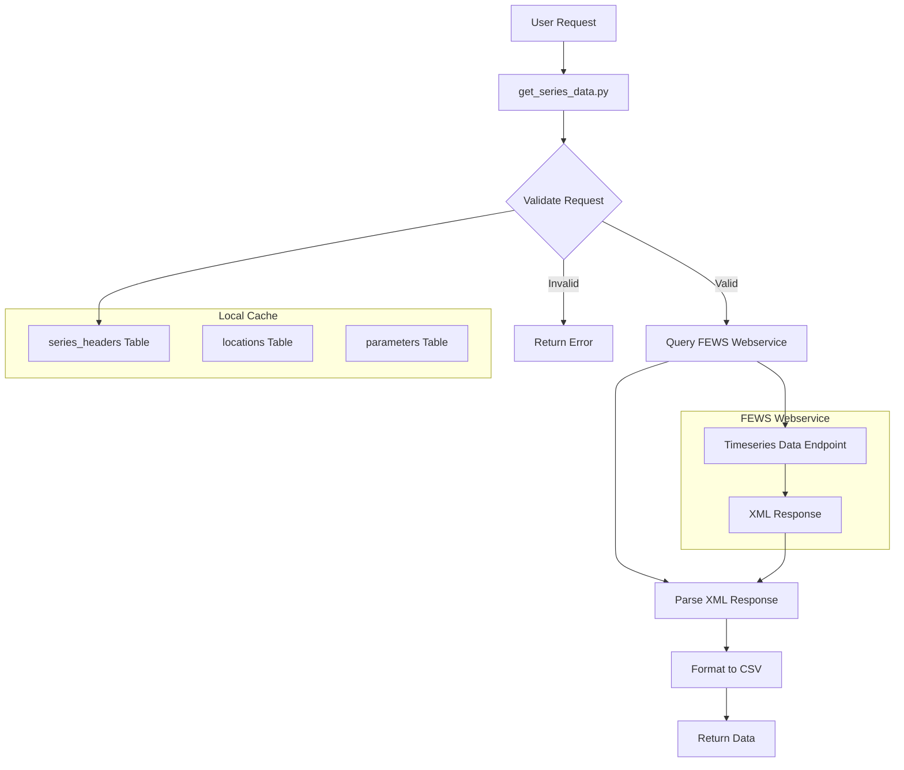

# Plan: Timeseries Data Retrieval Implementation

## Overview
This plan outlines the implementation of a new get_series_data tool that allows users to retrieve timeseries data from the FEWS webservice for specific location-parameter combinations. The tool will leverage our existing series_headers table to validate requests and provide efficient data retrieval, returning data in a row-oriented CSV format.

## Architecture

### System Architecture Diagram


## Implementation Details

### 1. Data Model

#### GetSeriesDataInput
```python
class GetSeriesDataInput(BaseModel):
    location_id: str = Field(..., description="Location ID to fetch data for")
    parameter_id: str = Field(..., description="Parameter ID to fetch data for")
    start_time: datetime = Field(..., description="Start time for data retrieval")
    end_time: datetime = Field(..., description="End time for data retrieval")
```

#### TimeseriesValue
```python
class TimeseriesValue(BaseModel):
    datetime: datetime
    location_id: str
    station_name: str
    parameter_id: str
    moduleinstance_id: str
    value: float
    flag: int
```

#### GetSeriesDataOutput
```python
class GetSeriesDataOutput(BaseModel):
    values: List[TimeseriesValue]
    metadata: dict  # Contains header information like units, coordinates, etc.
    csv_data: str   # CSV formatted string with the specified columns
```

### 2. XML Structure

The FEWS webservice returns data in the following XML format:
```xml
<TimeSeries xmlns="http://www.wldelft.nl/fews/PI">
    <timeZone>0.0</timeZone>
    <series>
        <header>
            <type>accumulative</type>
            <moduleInstanceId>im.wiwb.knmi</moduleInstanceId>
            <locationId>KNMIUUR278</locationId>
            <parameterId>Eref.d</parameterId>
            <timeStep unit="second" multiplier="86400"/>
            <startDate date="2025-01-01" time="00:00:00"/>
            <endDate date="2025-02-01" time="00:00:00"/>
            <missVal>-999.0</missVal>
            <stationName>Heino</stationName>
            <lat>52.43386123567003</lat>
            <lon>6.2617263290456675</lon>
            <x>214472.0</x>
            <y>494367.0</y>
            <z>0.0</z>
            <units>mm</units>
        </header>
        <event date="2025-01-01" time="00:00:00" value="0.1" flag="0"/>
        <!-- More events... -->
    </series>
</TimeSeries>
```

### 3. CSV Output Format

The tool will output data in the following CSV format:
```csv
datetime,location_id,station_name,parameter_id,moduleinstance_id,value,flag
2025-01-01T00:00:00Z,KNMIUUR278,Heino,Eref.d,im.wiwb.knmi,0.1,0
2025-01-02T00:00:00Z,KNMIUUR278,Heino,Eref.d,im.wiwb.knmi,0.0,0
...
```

### 4. Implementation Steps

1. **XML Parsing Function**
```python
def parse_timeseries_xml(xml_content: str) -> Tuple[dict, List[TimeseriesValue]]:
    """
    Parse FEWS XML response into metadata and timeseries values.
    Handles missing values internally based on the missVal from header.

    Returns:
        Tuple[dict, List[TimeseriesValue]]: Metadata and list of values
    """
    root = ET.fromstring(xml_content)
    ns = {'pi': 'http://www.wldelft.nl/fews/PI'}

    # Parse header information
    header = root.find('.//pi:header', ns)
    missing_value = float(header.find('pi:missVal', ns).text)
    metadata = {
        'moduleinstance_id': header.find('pi:moduleInstanceId', ns).text,
        'station_name': header.find('pi:stationName', ns).text,
        # ... other metadata ...
    }

    # Parse events
    values = []
    for event in root.findall('.//pi:event', ns):
        date = event.get('date')
        time = event.get('time')
        value = float(event.get('value'))

        # Handle missing values: if value equals missing_value indicator, set to None
        value = None if value == missing_value else value

        values.append(TimeseriesValue(
            datetime=f"{date}T{time}Z",
            location_id=metadata['location_id'],
            station_name=metadata['station_name'],
            parameter_id=metadata['parameter_id'],
            moduleinstance_id=metadata['moduleinstance_id'],
            value=value,
            flag=int(event.get('flag'))
        ))

    return metadata, values
```

2. **CSV Conversion Function**
```python
def convert_to_csv(values: List[TimeseriesValue]) -> str:
    """
    Convert timeseries values to CSV format.
    """
    headers = ['datetime', 'location_id', 'station_name', 'parameter_id',
               'moduleinstance_id', 'value', 'flag']

    output = StringIO()
    writer = csv.DictWriter(output, fieldnames=headers)
    writer.writeheader()

    for value in values:
        writer.writerow(value.dict())

    return output.getvalue()
```

3. **Main Tool Implementation**
```python
def get_series_data(input: GetSeriesDataInput) -> GetSeriesDataOutput:
    # 1. Validate request using series_headers table
    validate_series_exists(input.location_id, input.parameter_id)

    # 2. Construct URL with proper datetime format
    url = (f"{base_url}?locationIds={input.location_id}"
           f"&parameterIds={input.parameter_id}"
           f"&startTime={input.start_time.isoformat()}Z"
           f"&endTime={input.end_time.isoformat()}Z"
           f"&documentFormat=PI_XML")

    # 3. Fetch and parse data
    xml_content = fetch_from_webservice(url)
    metadata, values = parse_timeseries_xml(xml_content)

    # 4. Convert to CSV
    csv_data = convert_to_csv(values)

    return GetSeriesDataOutput(
        values=values,
        metadata=metadata,
        csv_data=csv_data
    )
```

### 5. Error Handling

1. **XML Parsing Errors**
   - Invalid XML structure
   - Missing required elements
   - Namespace handling
   - Date/time format validation
   - Missing value format validation

2. **Data Validation**
   - Missing value handling (as specified in header, e.g. -999.0)
   - Proper conversion between None and missing_value indicator
   - Invalid numeric values
   - DateTime parsing errors
   - Flag validation

### 6. Testing Strategy

1. **Unit Tests**
   - XML parsing with different data structures
   - CSV conversion accuracy
   - DateTime handling
   - Missing value handling

2. **Integration Tests**
   - Full workflow with webservice
   - Error handling scenarios
   - Large dataset handling

## Dependencies

- `xml.etree.ElementTree` for XML parsing
- `pydantic` for data validation
- `datetime` for time handling
- `csv` for CSV formatting
- Existing series_headers table for validation

## Future Enhancements

1. **Performance Optimization**
   - Streaming parser for large XML responses
   - Batch processing for multiple series
   - Response compression

2. **Output Formats**
   - Support for JSON output
   - Support for Excel output
   - Support for Arrow/Parquet format

3. **Data Quality**
   - Extended flag information
   - Quality metadata
   - Data gap detection
