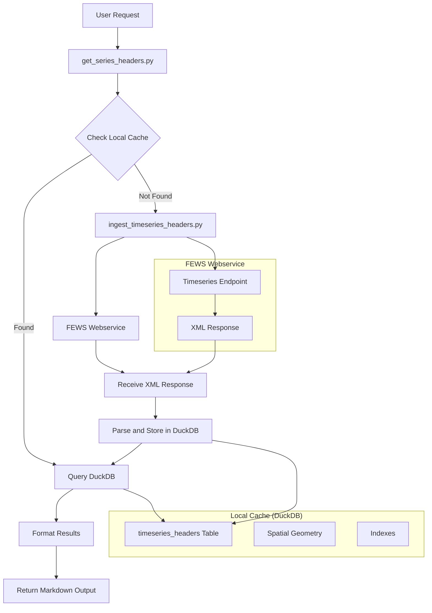

# Plan: Timeseries Headers Implementation

## Overview
This plan outlines the implementation of a new timeseries headers functionality that allows users to retrieve available timeseries header data from the FEWS webservice. The system will use an incremental caching approach where timeseries headers are only ingested when requested, rather than pre-loading all data upfront.

## Architecture

### System Architecture Diagram


### Data Flow Diagram
```
User Request → get_series_headers.py → Check Local Cache → 
├─ If Found: Return from DuckDB
└─ If Not Found: Call ingest_timeseries_headers.py → 
   Fetch from Webservice → Store in DuckDB → Return Results
```

### Components

1. **get_series_headers.py** - Main tool for retrieving series headers
2. **ingest_series_headers.py** - Tool for fetching and storing series headers from webservice
3. **SeriesHeader model** - Data model for series header information
4. **Database schema** - DuckDB table structure for caching series headers with foreign key relationships

## Implementation Details

### 1. Data Model (SeriesHeader)

Based on the XML example provided, a series header contains:
- `type` (e.g., "instantaneous")
- `moduleInstanceId` (e.g., "im.digiflow.model.hist.mswap")
- `locationId` (e.g., "GPG_1489") - Foreign key to locations table
- `parameterId` (e.g., "Kwel") - Foreign key to parameters table
- `timeStep` (unit and multiplier)
- `missVal` (missing value indicator)
- `timeZone` (e.g., "0.0")
- `qualifiers` (optional, e.g., "BUDGET.layers 7")

**Note**: Location details (stationName, lat, lon, x, y) and parameter details (units, name) are retrieved via foreign key relationships to existing tables. Time range information (startDate, endDate) is handled separately via `get_series_statistics` tool for operational data freshness.

### 2. Database Schema

```sql
CREATE TABLE series_headers (
    id INTEGER PRIMARY KEY,
    type VARCHAR,
    moduleInstanceId VARCHAR,
    locationId VARCHAR,
    parameterId VARCHAR,
    timeStepUnit VARCHAR,
    timeStepMultiplier INTEGER,
    missVal DOUBLE,
    timeZone VARCHAR,
    qualifiers VARCHAR,
    created_at TIMESTAMP DEFAULT CURRENT_TIMESTAMP,
    
    -- Foreign key constraints
    FOREIGN KEY (locationId) REFERENCES locations(locationId),
    FOREIGN KEY (parameterId) REFERENCES parameters(id)
);
```

-- Indexes for efficient queries
CREATE INDEX idx_series_headers_parameterId ON series_headers(parameterId);
CREATE INDEX idx_series_headers_locationId ON series_headers(locationId);
CREATE INDEX idx_series_headers_moduleInstanceId ON series_headers(moduleInstanceId);
CREATE INDEX idx_series_headers_type ON series_headers(type);
```

**Note**: Spatial geometry and detailed location/parameter information are retrieved via JOINs with existing tables.

### 3. Tool Implementation

#### Combined Filtering Strategy

The system uses cached data for combined queries to avoid redundant webservice calls. The approach is:

**Efficient Cached Filtering**: Once we have parameter data cached, we filter locally rather than making additional webservice calls.

### Implementation Strategy:

1. **Parameter-First Caching**:
   ```python
   # Step 1: Query by parameter and cache all results
   parameter_results = query_webservice("?parameterIds=Kwel")
   cache_timeseries_headers(parameter_results)
   
   # Step 2: Future combined queries use cached data
   combined_results = query_local_db("""
       SELECT * FROM timeseries_headers 
       WHERE parameterId = 'Kwel' AND locationId = 'GPG_1698'
   """)
   ```

2. **Location-First Caching**:
   ```python
   # Step 1: Query by location and cache all results
   location_results = query_webservice("?locationIds=GPG_1698")
   cache_timeseries_headers(location_results)
   
   # Step 2: Future combined queries use cached data
   combined_results = query_local_db("""
       SELECT * FROM timeseries_headers 
       WHERE parameterId = 'Kwel' AND locationId = 'GPG_1698'
   """)
   ```

3. **Cached Discovery**:
   ```python
   # Use series_headers table for parameter-location lookups
   def get_parameter_locations(parameter_id):
       return query_local_db("""
           SELECT DISTINCT locationId 
           FROM series_headers 
           WHERE parameterId = ?
           ORDER BY locationId
       """, [parameter_id])
   ```

4. **Cached Combined Query**:
   ```python
   def get_series_headers(parameter_id, location_id):
       # Check if we have this parameter cached
       if has_cached_parameter(parameter_id):
           # Query local cache for the specific combination
           results = query_local_db("""
               SELECT * FROM series_headers 
               WHERE parameterId = ? AND locationId = ?
           """, [parameter_id, location_id])
           
           if results:
               return results
           else:
               # Combination doesn't exist in our cache
               available_locations = get_parameter_locations(parameter_id)
               raise ValueError(f"Location {location_id} not found for parameter {parameter_id}. Available locations: {available_locations}")
       else:
           # First time seeing this parameter - do discovery and cache
           discover_and_cache_parameter(parameter_id)
           # Then query local cache as above
           return get_series_headers(parameter_id, location_id)
   ```

#### Query Types Supported

The system supports multiple query patterns:

1. **Parameter-based Queries**: `?parameterIds=Kwel`
   - Returns all timeseries for a specific parameter across all locations
   - Useful for analyzing a specific variable across the entire system

2. **Location-based Queries**: `?locationIds=GPG_1698`
   - Returns all timeseries for a specific location across all parameters
   - Useful for analyzing all variables at a specific monitoring point

3. **Combined Queries** (Cached Local Filtering):
   - Query local cache for specific parameter-location combinations
   - Returns timeseries for specific parameter at specific location
   - Most precise filtering option
   - Uses cached data for efficiency (no redundant webservice calls)

#### get_series_headers.py
- **Input**: `GetSeriesHeadersInput` with optional filters (parameter_id OR location_id)
- **Logic**: 
  1. Check if requested parameter/location exists in local cache
  2. If not found, call `ingest_series_headers.py`
  3. Query local DuckDB with JOINs to get complete information
  4. Return minimal but meaningful output
- **Output**: `GetSeriesHeadersOutput` with series headers summary

#### ingest_series_headers.py
- **Input**: `IngestSeriesHeadersInput` with parameter ID OR location ID
- **Logic**:
  1. Construct webservice URL with parameter or location filter
  2. Fetch XML data from FEWS webservice
  3. Parse XML and extract series headers
  4. Store in DuckDB with foreign key relationships
  5. Return ingestion summary
- **Output**: `IngestSeriesHeadersOutput` with status and SQL examples

### 4. Webservice Integration

**URL Patterns**: 
```
# By Parameter ID
{webservice_url}/rest/fewspiservice/v1/timeseries?parameterIds={parameterId}&onlyHeaders=True&documentFormat=PI_XML

# By Location ID
{webservice_url}/rest/fewspiservice/v1/timeseries?locationIds={locationId}&onlyHeaders=True&documentFormat=PI_XML

# By Multiple Parameters (future enhancement)
{webservice_url}/rest/fewspiservice/v1/timeseries?parameterIds={param1},{param2}&onlyHeaders=True&documentFormat=PI_XML

# By Multiple Locations (future enhancement)
{webservice_url}/rest/fewspiservice/v1/timeseries?locationIds={loc1},{loc2}&onlyHeaders=True&documentFormat=PI_XML
```

**Examples**: 
```
# Parameter-based query
https://actueelwaterbeeld-api.hkvservices.nl/FewsWebServices/rest/fewspiservice/v1/timeseries?parameterIds=Kwel&onlyHeaders=True&documentFormat=PI_XML

# Location-based query
https://actueelwaterbeeld-api.hkvservices.nl/FewsWebServices/rest/fewspiservice/v1/timeseries?locationIds=GPG_1698&onlyHeaders=True&documentFormat=PI_XML
```

### 5. File Structure

```
src/talk_with_fews/
├── models/
│   ├── get_series_headers.py              # Input/Output models
│   └── ingest_series_headers.py           # Ingest models
├── tools/webservice/
│   ├── get_series_headers.py              # Main retrieval tool
│   └── ingest_series_headers.py           # Ingestion tool
└── routers/
    └── tools_router_TalkWithWebservice.py # Router registration
```

### 6. Minimal Output Model Design (Cost Optimization)

#### Problem
Traditional output models return verbose markdown tables that are expensive in AI applications where every character costs money.

#### Solution: Minimal but Meaningful Output

**GetSeriesHeadersOutput Model (User-Facing):**
```python
class GetSeriesHeadersOutput(BaseModel):
    count: int = Field(..., description="Number of series found")
    summary: str = Field(..., description="Brief summary (max 200 chars)")
    sample_ids: List[str] = Field(..., description="First 3 series IDs for reference")
    available_filters: Dict[str, List[str]] = Field(
        default_factory=dict, 
        description="Available values for user-friendly filtering options"
    )
    follow_up_suggestions: List[str] = Field(
        default_factory=list,
        description="User-friendly suggestions for next analysis steps (max 3)"
    )
```

#### Example Outputs:

**Parameter Query (`?parameterIds=Kwel`):**
```json
{
  "count": 156,
  "summary": "Found 156 Kwel series across 52 locations",
  "sample_ids": ["GPG_1489_Kwel", "GPG_705_Kwel", "GPG_2068_Kwel"],
  "available_filters": {
    "locations": ["GPG_1489", "GPG_705", "GPG_2068", "..."],
    "model_types": ["historical", "forecast"]
  },
  "follow_up_suggestions": [
    "Get series for specific location GPG_1489",
    "Filter by historical model data",
    "Analyze spatial distribution of Kwel series"
  ]
}
```

**Location Query (`?locationIds=GPG_1698`):**
```json
{
  "count": 89,
  "summary": "Found 89 series at GPG_1698 (Stuw Jachthuislaan)",
  "sample_ids": ["GPG_1698_msw_Ssdtot", "GPG_1698_msw_Tact", "GPG_1698_Kwel"],
  "available_filters": {
    "parameters": ["msw_Ssdtot", "msw_Tact", "Kwel", "bdgETact", "..."],
    "model_types": ["historical", "forecast"]
  },
  "follow_up_suggestions": [
    "Get series for specific parameter Kwel",
    "Analyze time ranges and data coverage",
    "Compare with other locations in the region"
  ]
}
```

**Combined Query (Cached):**
```json
{
  "count": 2,
  "summary": "Found 2 Kwel series at GPG_1698",
  "sample_ids": ["GPG_1698_Kwel_hist", "GPG_1698_Kwel_fcst"],
  "available_filters": {
    "types": ["instantaneous"],
    "model_types": ["historical", "forecast"]
  },
  "follow_up_suggestions": [
    "Get detailed properties of these series",
    "Compare historical vs forecast data",
    "Analyze time series data values"
  ]
}
```

#### Benefits:
1. **Cost Efficient**: ~200 chars vs 2000+ chars in traditional tables
2. **User-Friendly**: Provides natural language suggestions without exposing internal system details
3. **Discoverable**: Shows available filter options in user-friendly terms
4. **Scalable**: Works for any result size
5. **Interactive**: Enables natural conversation flow without technical jargon

#### User Interface Design:
- **No Internal Logic Exposure**: Users never see webservice URLs, ingest processes, or database queries
- **Natural Language**: All suggestions use business terminology, not technical implementation details
- **Action-Oriented**: Focus on what users can do with the data, not how the system works internally

## Implementation Steps

### Phase 1: Data Models
1. Create `SeriesHeader` model in `base.py`
2. Create `GetSeriesHeadersInput` and `GetSeriesHeadersOutput` models (support parameter_id OR location_id)
3. Create `IngestSeriesHeadersInput` and `IngestSeriesHeadersOutput` models (support both query types)

### Phase 2: Database Schema
1. Add series_headers table creation to database initialization
2. Implement foreign key relationships to existing locations and parameters tables
3. Add appropriate indexes for performance
4. Update `setup_connections.py` to include series_headers table creation in the initialization process

### Phase 3: Ingestion Tool
1. Implement `ingest_series_headers.py` with XML parsing
2. Support both parameter-based and location-based queries
3. Implement foreign key validation and relationships
4. Implement error handling and validation
5. Add deduplication logic for overlapping queries
6. Handle XML namespaces and multiple series in single response
7. Validate data integrity with existing locations and parameters tables

### Phase 4: Retrieval Tool
1. Implement `get_series_headers.py` with caching logic
2. Add parameter-based and location-based filtering
3. Support combined filtering using cached data (no redundant webservice calls)
4. Implement minimal output formatting for cost optimization
5. Add query optimization with JOINs to existing tables
6. Implement parameter-location mapping discovery

### Phase 5: Integration
1. Register tools in router
2. Add to CLI interface
3. Update documentation and examples

## Key Features

### Incremental Caching
- Only fetch timeseries headers when requested
- Cache results in local DuckDB for subsequent queries
- Avoid large upfront data ingestion
- Smart cache invalidation based on query patterns
- Support for partial cache hits (e.g., parameter cached but location not)

### Spatial Support
- Store coordinates as spatial geometry
- Enable spatial queries (within polygon, distance-based)
- Compatible with existing location-based queries

### Flexible Filtering
- Filter by parameter ID
- Filter by location ID
- Filter by module instance
- Filter by time range
- Support for complex spatial queries
- Support for combined filters (parameter + location) using cached data
- Parameter-location mapping discovery and caching

### Performance Optimization
- Indexed queries for fast retrieval
- Spatial indexes for geographic queries
- Efficient XML parsing for large datasets

## Error Handling

1. **Webservice Errors**: Handle network timeouts, authentication failures, rate limiting
2. **XML Parsing Errors**: Validate XML structure, handle malformed data, namespace handling
3. **Database Errors**: Handle constraint violations, connection issues, spatial data validation
4. **Spatial Errors**: Validate coordinate data, handle projection issues, invalid geometries
5. **Data Validation**: Handle empty responses, missing required fields, invalid coordinate ranges
6. **Cache Errors**: Handle cache corruption, storage issues, index rebuild failures

## Testing Strategy

1. **Unit Tests**: Test individual components (parsing, database operations)
2. **Integration Tests**: Test webservice integration with mock data
3. **Performance Tests**: Test with large XML datasets
4. **Spatial Tests**: Test spatial query functionality

## Discovery Mechanisms

### Parameter-Location Discovery
To enable effective combined queries, we derive parameter-location relationships from the timeseries_headers table:

1. **Direct Discovery**: Query timeseries_headers table for parameter-location combinations
2. **Cached Relationships**: Use existing timeseries_headers data for fast lookups
3. **Validation**: Before combined queries, validate parameter-location combinations exist
4. **Auto-Suggestion**: Provide available locations when user specifies a parameter

### Discovery Strategies
```sql
-- Use existing series_headers table for parameter-location mappings
-- No separate mapping table needed!

-- Query for available locations for a parameter
SELECT DISTINCT locationId 
FROM series_headers 
WHERE parameterId = 'Kwel' 
ORDER BY locationId;

-- Query for available parameters at a location
SELECT DISTINCT parameterId 
FROM series_headers 
WHERE locationId = 'GPG_1698' 
ORDER BY parameterId;

-- Get parameter-location combinations with counts
SELECT parameterId, locationId, COUNT(*) as series_count
FROM series_headers 
GROUP BY parameterId, locationId
ORDER BY series_count DESC;

-- Get complete information with JOINs
SELECT sh.*, l.shortName, l.lat, l.lon, p.name, p.unit
FROM series_headers sh
JOIN locations l ON sh.locationId = l.locationId
JOIN parameters p ON sh.parameterId = p.id
WHERE sh.parameterId = 'Kwel' AND sh.locationId = 'GPG_1698';
```

## Future Enhancements

1. **Batch Processing**: Support for multiple parameter/location ingestion
2. **Time-based Caching**: Expire cached data after certain time period
3. **Advanced Filtering**: Support for complex query combinations (parameter + location + module)
4. **Data Validation**: Enhanced validation of timeseries header data
5. **Monitoring**: Add metrics for cache hit rates and performance
6. **Query Optimization**: Smart caching strategies based on query patterns
7. **Spatial Aggregation**: Group timeseries by geographic regions
8. **Discovery API**: Endpoint to query available parameter-location combinations

## Dependencies

- `xml.etree.ElementTree` for XML parsing with namespace support
- `geopandas` for spatial geometry handling
- `duckdb` for local caching with spatial extensions
- `pydantic` for data validation
- Existing webservice utilities for HTTP requests
- `lxml` (optional) for more robust XML parsing
- `shapely` for geometry operations and validation
