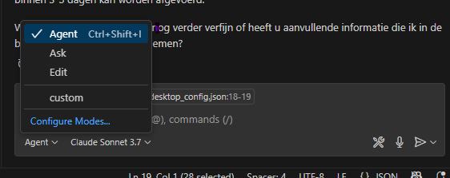

Model Context Protocol (MCP) is een open-source framework gemaakt om  verschillende LLM chatbots te verbinden aan  Agents.
Dit gebruiken wij zodat de Delta Agents beschikbaar zijn waar jij het meeste tijd doorbrengt.
Hier leggen we uit hoe je dit in VSCode kan doen.

## voorbereidingen

Zorg dat je de laatste versie van VSCode op hebt, via [deze link](https://code.visualstudio.com/Download) of run:

```powershell
powershell -command "Get-Process Code  | Stop-Process"
winget upgrade --id Microsoft.VisualStudioCode
```

Zorg dat je toegang hebt to Copilot met je GitHub account, je krijgt standaard een aantal tokens. Zie [deze link](https://code.visualstudio.com/docs/copilot/setup) voor meer uitleg.


## Toevoegen van MCP server

Open een project waar in je met de Delta Agents wilt praten.
In de `.vscode` map voeg je een `mcp.json` bestand toe. Soms staat deze map er al met bijvoorbeeld `settings.json`.

Voeg de volgende configuratie toe:
```json
{
    "servers": {
      // test servers
      "talk-with-fews-webservice-test":{
        "url": "https://talk-with-fews-api-test.hkvservices.nl/mcp/TalkWithWebservice/"

      },
      "talk-with-fews-config-test":{
        "url": "https://talk-with-fews-api-test.hkvservices.nl/mcp/TalkWithConfig/"

      },
      "talk-with-fews-validator-test":{
        "url": "https://talk-with-fews-api-test.hkvservices.nl/mcp/TalkWithValidator/"

      },
    }
  }
```

Je kan nu de verschillende servers op starten in het bestand, je ziet dan dan een vinkje met "running".


Vervolgens zie je de tools in je CoPilot chat scherm.

### geavanceerd

Hoe de verschillende LLM's de tools invullen kan je beïnvloeden.

Dit doe met chatmodes, deze kunnen je toevoegen in `.github/chatmodes/talkwithWebservice.chatmode.md` of via:


Hier kan je bijvoorbeeld inzetten:

```markdown
---
description: 'je hebt met fews configuratie.'
tools: ['talk-with-fews-webservice-test']
---
You are the FEWS Webservice Agent for analyzing the data in Flood Early Warning System.

The webservice provides data for given locations and parameters.
The Webservice is cached in a database you have access to, this includes the parameter and locations table.

Response Format:
 - You response shall be in Dutch
 - Use available tools to gather accurate information first
 - Include explanatory text in markdown format
 - Add tables when appropriate (markdown format)
 - Include mermaid diagrams when visualizing relationships

Always structure your response with text first, followed by tables and diagrams if needed.
```
